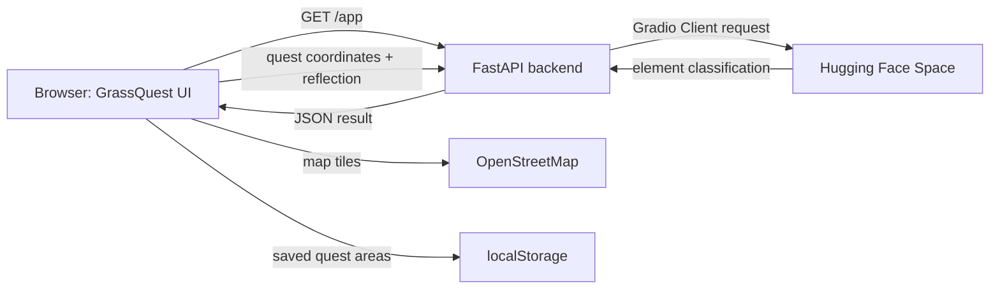

# GrassQuest

GrassQuest is a small outdoor-discovery app. It generates a nearby quest zone, accepts a written reflection, and asks an open-source model (Gemma3-4b in this case) running in Hugging Face Space to classify the observation as **Monsoon Water**, **Earthy Terra**, **Urban Flora**, or **Solar Heat**. The browser displays the result and records completed quest zones as elemental fog on a Leaflet map.

## Architecture



## Technology

- **Backend:** Python, FastAPI, Pydantic, Uvicorn, `python-dotenv`, and `gradio_client`.
- **Frontend:** HTML, CSS, and vanilla JavaScript; Tailwind CSS and Phosphor Icons via CDN.
- **Map:** Leaflet 1.9.4 with OpenStreetMap tiles.
- **Classification:** Google's `google/gemma-3-4b-it` model hosted in a Hugging Face Space and called through the Gradio Client.
- **Hosting:** Render (configured by `render.yaml`).

## Open-source tools and services

- FastAPI, Pydantic, Uvicorn, and Python dotenv for the API and local configuration.
- Hugging Face Hub/Gradio Client for calling the Space; Gemma 3 model hosting is provided by Hugging Face Spaces.
- Leaflet for interactive maps and OpenStreetMap for map data and tiles.
- Tailwind CSS, Phosphor Icons, and the Inter/Lora fonts are loaded by the page from their public CDNs.

Review the license and usage terms for each dependency, model, font, and hosted service before redistributing or deploying the application.

## Prerequisites

- Python 3.10 or newer.
- A Hugging Face account and a running Space exposing the classification API described below.
- A Hugging Face read token configured on the backend.

## Initial configuration

1. Clone or download this project and open a terminal in its root directory.
2. Create and activate a virtual environment:

   **Windows PowerShell**

   ```powershell
   py -m venv .venv
   .\.venv\Scripts\Activate.ps1
   ```

   **macOS/Linux**

   ```bash
   python3 -m venv .venv
   source .venv/bin/activate
   ```

3. Install the backend dependencies:

   ```bash
   python -m pip install --upgrade pip
   python -m pip install -r requirements.txt
   ```

4. Create a `.env` file in the project root. Keep this file private; it is excluded by `.gitignore`.

   ```dotenv
   HF_USERNAME=your-hugging-face-username
   HF_SPACE_NAME=your-space-name
   HF_TOKEN=hf_your_read_token
   ```

   The backend also accepts the legacy `.env` names `USERNAME` and `SPACE_NAME`. Prefer `HF_USERNAME` and `HF_SPACE_NAME` for new setup. Do not put the token in HTML, JavaScript, a URL, or a committed file.

The frontend and API share the same origin when you use `/app`, so no CORS configuration is needed for the normal local or Render setup. If you intentionally host the frontend on a different origin, set `CORS_ALLOWED_ORIGINS` on the backend to a comma-separated list of exact trusted origins (for example, `https://grassquest-ui.example.com`). Do not use `*`; a page opened as a local `file://` is not an allowed production origin.

## Hugging Face Spaces setup

1. Create a Hugging Face Space using the **Gradio** SDK, then accept Google's Gemma model terms on the Hugging Face model page if prompted.
2. Upload the **contents** of this project's `hf_spaces/` folder to the root of the Space repository (`app.py`, `requirements.txt`, and `README.md`). The Space metadata selects `app.py` as its entry point.
3. In the Space settings, select GPU hardware. The app loads the model onto CUDA and uses the `spaces.GPU` decorator.
4. Hugging Face installs the Space's `requirements.txt` and starts `app.py` automatically. Wait for the build to finish and test a reflection in the Gradio page.
5. The app exposes a Gradio API endpoint named `/classify_reflection` that accepts a string parameter named `reflection_text` and returns one of these exact strings:
   - `Monsoon Water`
   - `Earthy Terra`
   - `Urban Flora`
   - `Solar Heat`
6. Create a Hugging Face **read** access token. For a private Space, ensure the account/token has permission to access it.
7. Set `HF_USERNAME`, `HF_SPACE_NAME`, and `HF_TOKEN` in the backend's local `.env` file. The username and Space name identify the Space at `username/space-name`; the token remains on the backend.

The backend calls the Space as `username/space-name` with `api_name="/classify_reflection"`. If the Space uses a different function name or input parameter, update its Gradio API to match this contract.

## Run locally

Start the FastAPI server from the project root:

```bash
python -m uvicorn backend.main:app --reload --host 127.0.0.1 --port 8000
```

Open **http://127.0.0.1:8000/app** in Chrome. Serve the page through FastAPI rather than opening the HTML file directly; this gives the frontend and API the same origin and ensures `/fogmap.js` loads correctly. Allow location access in the browser to generate quest waypoints. The map uses OpenStreetMap tiles, so an internet connection is required for the map background and external CDN assets.

Useful API routes:

- `GET /` — basic API welcome response.
- `GET /app` — GrassQuest frontend.
- `GET /docs` — interactive FastAPI API documentation.
- `POST /api/submit-quest` — classify a form-encoded reflection and coordinates.

Example request:

```bash
curl -X POST http://127.0.0.1:8000/api/submit-quest \
  -H "Content-Type: application/x-www-form-urlencoded" \
  --data-urlencode "latitude=13.0827" \
  --data-urlencode "longitude=80.2707" \
  --data-urlencode "reflection=The trail was slick after rain."
```

The successful response contains the submitted coordinates and reflection, the element returned by the Space, and a user-facing message. Reflections are limited to 150 characters, and the endpoint allows two submissions per day per client IP. The browser stores completed quest areas in its own `localStorage`; this data is local to that browser and is not a backend database.

## Deploy to Render

1. Push the project to a Git repository without `.env` or any Hugging Face token.
2. In Render, create a Blueprint deployment from the repository. Render reads the service configuration from `render.yaml`.
3. Add the values for `HF_USERNAME`, `HF_SPACE_NAME`, and `HF_TOKEN` in the service's environment settings. The blueprint marks these values as manually supplied (`sync: false`).
4. Deploy and open `https://<your-render-service>.onrender.com/app`.

The API and frontend are served by the same Render service. Do not add Hugging Face credentials to Render's static/frontend assets.

## Security and privacy notes

- `.env` and virtual-environment files are ignored by Git. Verify `git status` before pushing and never commit credentials.
- If a token has ever been committed or shared, revoke it in Hugging Face and create a replacement.
- The quest endpoint is unauthenticated. CORS limits which browser origins can call it, but it does not prevent direct HTTP clients from doing so. SlowAPI limits submissions to two per day per client IP using in-memory storage; counters reset when the process restarts and are not shared between multiple service instances.
- Reflections and precise quest coordinates are sent to the configured Hugging Face Space for classification. The map's completed zones are stored in browser `localStorage`.
- The HTML currently loads some libraries and fonts from public CDNs and map tiles from OpenStreetMap. Tailwind's CDN script is convenient for this small app; for a production build, bundle Tailwind locally and review external-service privacy, licensing, and availability requirements.
